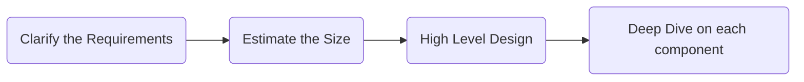

# What is Back-of-the-Envelope ?

Before you design a system, decide the LB, Servers, Database, Cache you need to know a few estimates:

* How much data arrives every second ?
* How much of it you have to keep ?

These estimates are used as part of Back-of-the-envelope calculation which is called so as the numbers are suppose to fit on back of an envelop.

> **Back-of-the-envelope** estimation is a rough calculation, that tells you the approximate size of the system you are about to design.

## Estimation steps:

> Write down the assumptions (how much ?) >>>  100 million users, 10 pecentage post daily, 500KB a photo

> Arithmetic (calculate per day & per hour) >>>  10 million writes per day, 100 writes per second, 5TB a day

>What it implies for the design >>> Read Heavy, Needs a cache and a CDN, Object Storage

## Rules for estimation:

* Round aggressively. Use 100,000 seconds in a day instead of 86,400 for ease of estimate calculation.
* Do one number at a time. Start with Requests per second, then storage, then bandwidth
* Say the assumption out loud before you use it. 

Estimation needs system requirements, it sits between clarifying the requirements and drawing the high-level design.

## What is the data size (data Sizing)?

Based on the type of data a system handles, it is helpful to know type of data & size of data in the system.
This concept will ease the further calculation.

| Unit          | Roughly               | Something that size                  |
| ------------- | --------------------- | ------------------------------------ |
| Byte          | One character of text | The letter A                         |
| Kilobyte (KB) | A thousand bytes      | A page of plain text                 |
| Megabyte (MB) | A million bytes       | A high quality photo                 |
| Gigabyte (GB) | A billion bytes       | A feature length movie               |
| Terabyte (TB) | A thousand GB         | A laptop hard drive                  |
| Petabyte (PB) | A thousand TB         | The photo library of a large service |

### Few sizes worth memorizing are the ones you will multiply by a user count.

| Object                               | Assume            |
| ------------------------------------ | ----------------- |
| A short text post, with its metadata | Hundreds of bytes |
| A thumbnail image                    | Tens of KB        |
| A compressed photo                   | Hundreds of KB    |
| A minute of streaming video          | Tens of MB        |

### How long an operations take?

| Operation                         | Roughly          |
| --------------------------------- | ---------------- |
| Read from memory                  | 100 nanoseconds  |
| Read from an SSD                  | 100 microseconds |
| Round trip inside one data center | 500 microseconds |
| Seek on a spinning disk           | 10 milliseconds  |
| Round trip across the world       | 150 milliseconds |

## Time Calculation 

The focuse here is 24hours (per day) & Seconds calculation for traffic in a system design.
This help work the QPS part of estimation given by the business team, where you will want to estimate the per second traffic to the system being built. 

> **Remember** A day has 86,400 seconds. Round it to 100,000.

| Per day	Traffic | How many request per second ? |
| --------------- | ----------------------------- |
| 100,000         | 1                             |
| 1 million       | 10                            |
| 100 million     | 1,000                         |
| 1 billion       | 10,000                        |

* divide by 100000 OR drop 5 zeros 
Dividing a daily count by 100,000 seconds turns a business number into a requests-per-second number by dropping five zeros.

> **Remember**  Traffic is never spread evenly across the day, so the average is not the number to build for. 
> Peak traffic is commonly two to three times the average, and a service with a sharp daily cycle can be higher still. 
> State the multiplier you are using and apply it once, at the end.

## Estimation Flow :

* How much traffic? = QPS (Query per second)
* How much data kept? = Storage
* How much data moved? = bandwidth
* Do we need a cache ?

### Traffic (QPS)
Start with writes, because writes are usually the smaller and better understood number, then derive reads from them.

Key Consideration: 
* Daily active users X Write actions per user gives actions per day  

* Divide by 100,000 to get the average per second.

* Multiply by the read to write ratio to get read traffic from write traffic.
> The ratio decides whether the design is about handling writes or about serving reads, and those lead to different systems.

* Multiply by two or three for peak.

### Storage

Storage is the amount of new data written each day, multiplied by how long you keep it.

* Writes per day times the size of one object gives daily storage, 
* multiplied by the retention period of the object
* then by the replication factor to get the real total number for storage
* Metadata is the third smallest multiplier to consider for accuracy 

### Bandwidth 

Bandwidth is data per second, so it is QPS multiplied by the size of one object.

* Incoming bandwidth is write QPS times object size 
* Outgoing bandwidthis read QPS times object size

### Cache Memory - How much memory a cache needs?

The usual assumption is that a small share of the content gets most of the requests, often stated as 20 percent of the objects serving 80 percent of the reads. 

Cache size is calculated by taking the 1/5 of objects accessed in a day and multiplyed by the object size.

Flow of estimation:

| Step      | Needs                                          | Produces                      |
| --------- | ---------------------------------------------- | ----------------------------- |
| Traffic   | Users, actions per user, read to write ratio   | Write QPS, read QPS, peak QPS |
| Storage   | Write QPS, object size, retention, replication | Total data kept               |
| Bandwidth | Both QPS numbers, object size                  | Bytes per second in and out   |
| Memory    | Read traffic, object size, hit ratio           | Cache size                    |

 For better understanding, lets build on above concepts. Back-of-the-envelope estimation is a rough calculation with round numbers that tells you the approximate size of a system before you design it. It exists to test whether a design is feasible, to size its components, and to show your reasoning. 

